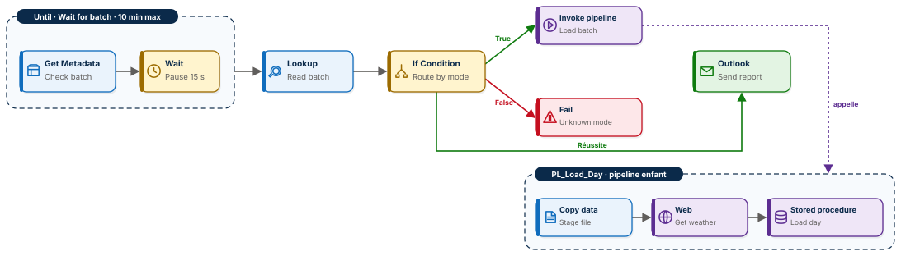

# 🎼 Fabric Pipeline Express 4 : attendre, router, appeler, remplacer

Deux pipelines Microsoft Fabric Data Factory qui travaillent comme une équipe de production. Un orchestrateur attend l'arrivée d'un lot, lit son manifeste, décide de la route selon le mode du lot et appelle un pipeline enfant. L'enfant charge les ventes dans un entrepôt, interroge une API météo publique et remplace la journée par une procédure stockée, en gardant la trace de chaque correction. Onze activités, onze types, aucune ligne de code dans les pipelines, et un chargement que l'on peut rejouer autant de fois que l'on veut.

**Guide PDF de 7 pages inclus** : [`Pipeline_Fabric_Guide.pdf`](Pipeline_Fabric_Guide.pdf). Chaque activité, chaque champ, chaque expression, et les chiffres à retrouver à l'unité près. Toutes les expressions sont aussi dans [`data/expressions.txt`](data/expressions.txt), prêtes à copier.



## 📸 Aperçu

L'orchestrateur après une exécution réussie : la boucle d'attente, la lecture du manifeste, la condition qui appelle l'enfant ou refuse le lot, l'e-mail de bilan.


Le pipeline enfant : copie vers la zone de transit, appel de l'API météo, procédure stockée qui remplace la journée.


La table `fact_sales` après les sept exécutions : cinq journées, chacune en un seul exemplaire, avec la météo réelle de Metz et le lot qui l'a chargée. La journée du 6 porte le lot de correction.


L'espace de travail et son lignage : le lakehouse, l'entrepôt, les deux pipelines et leurs connexions.


## 🎯 Résultats clés

| Indicateur | Valeur |
|---|---|
| Pipelines | 2, un orchestrateur et un enfant |
| Activités | 11 (Until, Get Metadata, Wait, Lookup, If Condition, Invoke pipeline, Fail, Office 365 Outlook, Copy data, Web, Stored procedure) |
| Lignes de code dans les pipelines | 0 |
| Lots traités | 6 lots, 7 exécutions : 4 standard, 1 correction, 1 refus puis sa reprise |
| Lignes dans `fact_sales` | 150, cinq journées de 30 lignes, aucune en double |
| Chiffre d'affaires final | 5 512,60, après correction |
| Montant corrigé | 76,50 retirés : 9 salades saisies en double à Nancy |
| Journées enrichies par l'API météo | 5 sur 5, température maximale et pluie réelles |

## 💼 Impact métier

Trois cafés, à Metz, Nancy et Thionville, déposent chaque soir leurs ventes. Le chiffre d'affaires du jour doit être juste, même quand un magasin renvoie son fichier corrigé le lendemain, et même quand un lot arrive en retard. Ce projet répond aux trois questions qu'un responsable pose toujours : le lot est-il arrivé, les chiffres sont-ils les bons, et qu'est-ce qui a changé depuis hier ? Le pipeline attend sans qu'on le relance, refuse ce qu'il ne connaît pas, remplace une journée au lieu de la doubler, et inscrit dans une table d'audit chaque chiffre modifié, avant et après.

## 📝 Résumé

`PL_Orchestrator` reçoit un seul paramètre, l'identifiant du lot. Une boucle Until interroge le lakehouse toutes les quinze secondes, pendant dix minutes au plus, jusqu'à ce que le manifeste `batch_<lot>.json` existe. Un Lookup le lit : fichier, journée, mode. Une If Condition vérifie que le mode est connu (`standard` ou `correction`) : si oui, elle appelle `PL_Load_Day` avec les quatre valeurs du manifeste ; sinon, une activité Fail refuse le lot en nommant le mode reçu. Un e-mail Outlook envoie le bilan.

`PL_Load_Day` copie le fichier de ventes dans une table de transit de l'entrepôt, interroge l'API Open-Meteo pour la température maximale et la pluie du jour à Metz, puis appelle la procédure `usp_load_day`. La procédure agrège les tickets par café et produit, supprime la journée existante, insère la nouvelle avec la météo, et, en mode correction, enregistre d'abord le chiffre d'affaires avant et après dans `audit_restatements`.

## 🔁 Pipeline

| Pipeline | Activité | Type | Rôle |
|---|---|---|---|
| Orchestrateur | `Wait for batch` | Until | Boucle jusqu'à ce que le manifeste existe, dix minutes au plus |
| Orchestrateur | `Check batch` | Get Metadata | Dans la boucle : `batch_<lot>.json` existe-t-il dans `inbox` ? |
| Orchestrateur | `Pause` | Wait | Dans la boucle : quinze secondes avant de revérifier |
| Orchestrateur | `Read batch` | Lookup | Lit `mode`, `file`, `run_date`, `batch_id` |
| Orchestrateur | `Route by mode` | If Condition | Le mode est-il `standard` ou `correction` ? |
| Orchestrateur | `Load batch` | Invoke pipeline, True | Appelle `PL_Load_Day` avec les quatre valeurs du manifeste |
| Orchestrateur | `Unknown mode` | Fail, False | Refuse le lot : « Mode de lot inconnu : test » |
| Orchestrateur | `Send report` | Office 365 Outlook | Le bilan du lot |
| Enfant | `Stage file` | Copy data | Fichier de ventes vers `dbo.stg_sales` |
| Enfant | `Get weather` | Web | `api.open-meteo.com` : `temperature_2m_max` et `precipitation_sum` du jour |
| Enfant | `Load day` | Stored procedure | `dbo.usp_load_day` : remplace la journée, journalise les corrections, vide le transit |

## 🧠 Les quatre idées du projet

**Attendre un signal, pas une heure.** Le pipeline ne suppose pas que le fichier est là : il le vérifie. Get Metadata avec le champ *Existe* renvoie `false` sans erreur quand le fichier manque, ce qui en fait le seul test d'existence propre dans un pipeline. La boucle Until s'arrête dès qu'il passe à `true`, ou échoue proprement au bout de dix minutes.

**Router selon le contenu, pas selon le pipeline.** Le mode est écrit dans le manifeste, pas dans le pipeline. Un mode inconnu n'est ni tenté ni ignoré : il est refusé avec son nom dans le message d'erreur.

**Séparer celui qui décide de celui qui travaille.** L'orchestrateur ne connaît ni les tables ni l'API ; l'enfant ne sait pas d'où vient le lot. Demain, une nouvelle route appellera un autre enfant sans toucher à celui-ci.

**Remplacer, jamais ajouter.** La procédure supprime la journée avant de l'insérer. Rejouer un lot donne le même résultat ; une correction remplace la journée et laisse une trace dans l'audit.

## 🧬 Traçabilité

```
LH_Market / Files / inbox / batch_2026-10-06-2.json      { mode: correction, file: sales_2026-10-06_corrige.csv }
   │  Until Wait for batch ── Get Metadata Check batch ── Wait Pause 15 s
   ▼
Lookup Read batch
   ▼
If Condition Route by mode
   ├──True──▶ Invoke pipeline Load batch ──▶ PL_Load_Day
   │                                           │  Copy data Stage file   inbox/sales_… .csv ──▶ WH_Market.dbo.stg_sales
   │                                           │  Web Get weather        api.open-meteo.com  ──▶ 23.8 °C, 0.0 mm
   │                                           ▼  Stored procedure Load day
   │                                              dbo.audit_restatements  NANCY 470,10 ──▶ 393,60
   │                                              dbo.fact_sales          2026-10-06 remplacée, 30 lignes
   └──False─▶ Fail Unknown mode   « Mode de lot inconnu : test »
   ▼
Office 365 Outlook Send report
```

## 🏗️ Architecture

Un lakehouse `LH_Market` sert de boîte de dépôt : fichiers de ventes et manifestes dans `Files/inbox`. Un entrepôt `WH_Market` porte toute la logique de données :

| Objet | Rôle |
|---|---|
| `dbo.stg_sales` | Zone de transit en texte brut, vidée à chaque chargement |
| `dbo.fact_sales` | Une ligne par journée, café et produit, avec `temp_max_c`, `rain_mm`, `batch_id`, `loaded_at` |
| `dbo.audit_restatements` | Chiffre d'affaires avant et après chaque correction, par café |
| `dbo.usp_load_day` | La procédure qui agrège, remplace et journalise |

La transformation vit dans la procédure, pas dans le Copy : le transit reçoit du texte, la procédure convertit les types. Le Copy n'a jamais à deviner une colonne.

## ▶️ Les sept exécutions

| # | `batch_id` | Mode | Ce qui se passe | `fact_sales` |
|---|---|---|---|---|
| 1 | `2026-10-04-1` | standard | Chargement, e-mail de bilan | 30 |
| 2 | `2026-10-05-1` | standard | Chargement | 60 |
| 3 | `2026-10-06-1` | standard | Chargement ; Nancy compte 9 salades en double | 90 |
| 4 | `2026-10-06-2` | correction | Journée du 6 remplacée, Nancy passe de 470,10 à 393,60, 3 lignes d'audit | 90 |
| 5 | `2026-10-07-1` | test | Refusé : « Mode de lot inconnu : test », table intacte | 90 |
| 6 | `2026-10-07-1` | standard | Manifeste corrigé et redéposé, chargement | 120 |
| 7 | `2026-10-08-1` | standard | Lancé avant le dépôt du manifeste : la boucle attend, le fichier arrive, le lot se charge | 150 |

## 📊 Résultat final

```sql
SELECT sale_date, COUNT(*) AS lignes, SUM(qty) AS articles, SUM(revenue) AS ca,
       MAX(temp_max_c) AS temp_max, MAX(rain_mm) AS pluie, MAX(batch_id) AS lot
FROM dbo.fact_sales GROUP BY sale_date ORDER BY sale_date;
```

| sale_date | lignes | articles | ca | temp_max | pluie | lot |
|---|---|---|---|---|---|---|
| 2026-10-04 | 30 | 309 | 1 076,20 | 19,9 | 0,0 | 2026-10-04-1 |
| 2026-10-05 | 30 | 317 | 1 039,00 | 23,0 | 0,0 | 2026-10-05-1 |
| 2026-10-06 | 30 | 343 | 1 157,50 | 23,8 | 0,0 | **2026-10-06-2** |
| 2026-10-07 | 30 | 315 | 1 042,50 | 24,6 | 0,9 | 2026-10-07-1 |
| 2026-10-08 | 30 | 342 | 1 197,40 | 17,0 | 12,4 | 2026-10-08-1 |

Les températures et la pluie sont les valeurs réelles de Metz renvoyées par l'API Open-Meteo pour chaque journée.

## 📦 Jeu de données

```
data/
├── sales_2026-10-04.csv            226 lignes
├── sales_2026-10-05.csv            230 lignes
├── sales_2026-10-06.csv            257 lignes, 9 salades en double à Nancy
├── sales_2026-10-06_corrige.csv    248 lignes, la version corrigée
├── sales_2026-10-07.csv            237 lignes
├── sales_2026-10-08.csv            247 lignes
├── batch_2026-10-04-1.json … batch_2026-10-08-1.json   un manifeste par lot
└── expressions.txt                 toutes les expressions du guide, prêtes à copier
```

Une ligne par article vendu : `sale_date`, `sale_time`, `shop`, `product`, `qty`, `unit_price`. Dix produits, trois cafés. Chaque manifeste porte quatre clés :

```json
{ "batch_id": "2026-10-06-2", "mode": "correction", "file": "sales_2026-10-06_corrige.csv", "run_date": "2026-10-06" }
```

Données de ventes fictives, conçues pour l'exercice. Données météo : [Open-Meteo](https://open-meteo.com/).

## 🚀 Reproduire l'exercice

1. Créer un lakehouse `LH_Market`, un dossier `Files/inbox`, et y déposer tous les fichiers de `data/` sauf `batch_2026-10-08-1.json`.
2. Créer un entrepôt `WH_Market` et exécuter le script SQL de la page 3 du guide : trois tables et la procédure `usp_load_day`.
3. Construire `PL_Load_Day`, puis `PL_Orchestrator`, en suivant le guide et en copiant les expressions depuis `data/expressions.txt`.
4. Exécuter les sept lots du tableau ci-dessus et retrouver les chiffres du résultat final.

## 🧰 Stack technique

Microsoft Fabric Data Factory · Lakehouse · Warehouse et T-SQL · API REST Open-Meteo · Office 365 Outlook

## ✅ Conclusion

Un pipeline de production ne se contente pas de copier. Il attend ce qu'il doit attendre, refuse ce qu'il ne connaît pas, délègue le travail à un pipeline spécialisé, et laisse les données dans un état qu'on peut rejouer et auditer. Deux pipelines, onze activités, une procédure : c'est suffisant pour tout cela.

## 💭 Dernier mot

Le bon chiffre n'est pas celui qu'on charge en premier. C'est celui qu'on peut corriger sans jamais le perdre de vue.

---

Abdoul Hamid Diallo · Microsoft Data & AI Engineer · Microsoft Certified DP-600, DP-700, PL-300, AI-102, DP-100, AI-900, DP-900 · [LinkedIn](https://www.linkedin.com/in/abdoul-hamid-diallo-fabric-data-engineer/)
